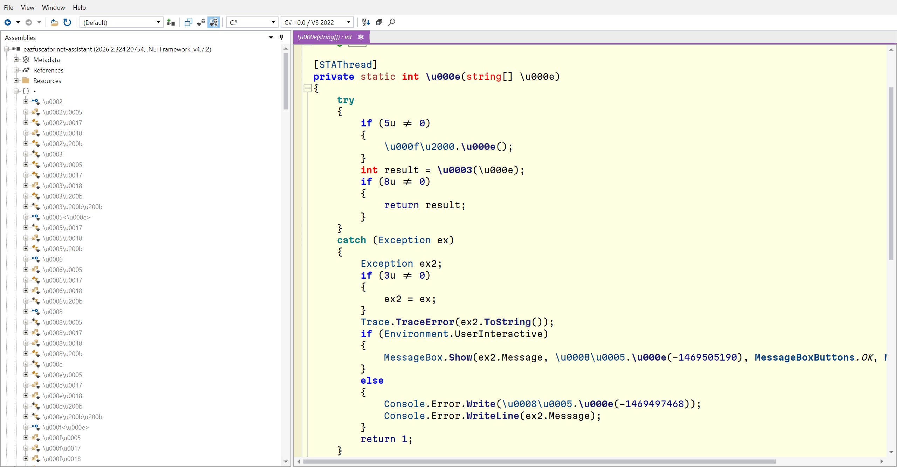
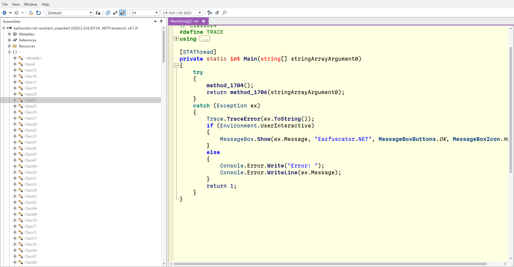
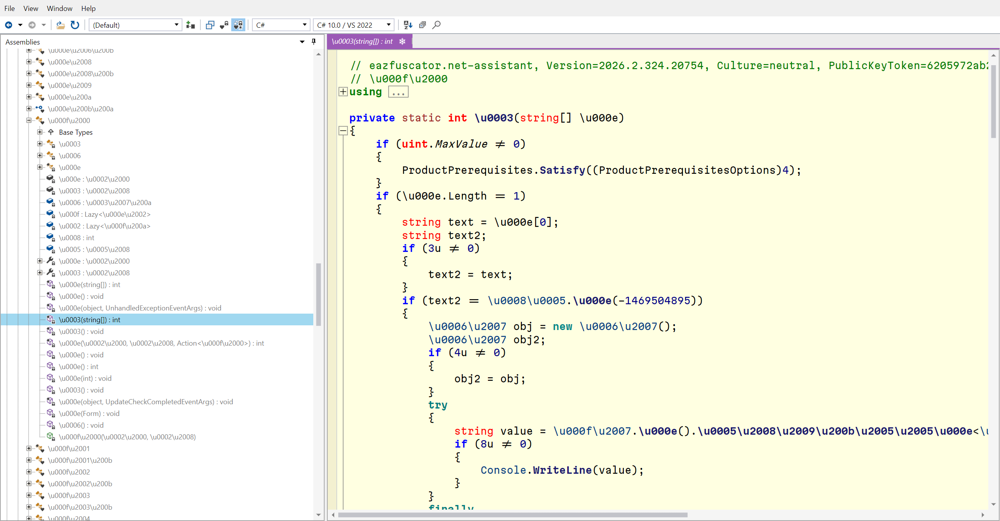
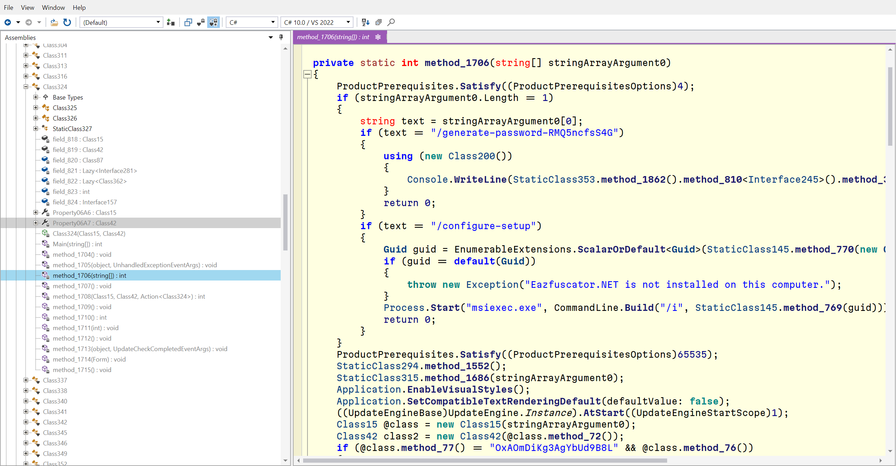

# EazUnpacker

面向 **Eazfuscator.NET 托管程序集**的命令行解包与反混淆工具。恢复可分析的 IL，生成可读名称，并可选导出 C# 工程。

**简体中文** · [English](README.en.md) · **v1.1.0** · [更新日志](CHANGELOG.md)

[快速开始](#快速开始) · [功能特点](#主要功能) · [参数](#参数与退出码) · [日志](#日志与统计) · [常见问题](#常见问题) · [开发](#开发与测试)

> 按元数据与 IL 语义识别保护，不按样本名称或预设密钥表匹配。支持范围以实际恢复报告为准，不承诺任意样本“完全还原”。

## 主要功能

| 能力 | 说明 |
| --- | --- |
| 字符串与资源 | 恢复受支持的字符串、资源及内嵌程序集；提取并核对 Costura 托管依赖身份 |
| VM 还原 | 识别 VM 格式和调用点，恢复受支持的指令、签名及异常区域；失败时保留原方法 |
| 内联与代理 | 恢复一个宿主内的多个 VM 调用；支持受约束的 `ref` 写回；整理透明代理链，内联有界的纯整数叶表达式 |
| 控制流 | 折叠可证明的整数/枚举条件，整理 switch 分发、跳转链与单前驱常量，删除不可达指令和无用局部写入 |
| 可读命名 | 按类型角色、继承和入口点生成名称，精简参数名，保留名称映射与 Portable PDB |
| 密钥日志 | 通过原校验后输出密钥、Token、输入中的原命名空间/类名/方法签名；保留结构化记录 |
| 可选源码导出 | 使用 ILSpy 导出 C# 工程、字符串索引并尝试重构建 |
| 可选 CLR 检查 | 显式检查恢复后的宿主、内联适配器及访问桥；**默认关闭** |

## 快速开始

### 1. 解压完整发布包

解压 `EazUnpacker-v1.1.0-win.zip`，保留 `worker\modern` 等所有子目录。入口为 `Unpacker.exe`，不要只复制 EXE。

- **运行环境**：Windows、.NET Framework 4.8；处理现代 .NET 目标还需要相应的 .NET Desktop Runtime。现代后端以 .NET 8 为目标，可向已安装的更新主版本滚动。
- **目录权限**：解压到较短的可写目录，程序会在自身目录建立 `temp`。Framework 加载器或第三方工具仍可能受 Windows 长路径限制。
- **是否需要 SDK**：普通解包不需要；源码重构建需要 .NET SDK 和目标项目所需引用。开发构建见[开发与测试](#开发与测试)。

### 2. 运行命令

在解压后的目录打开 PowerShell：

```powershell
# 默认：恢复 IL 并输出程序，不执行 CLR 准备检查，不导出源码
.\Unpacker.exe unpack "C:\samples\input.dll" "C:\output\input_unpacked.dll"

# 显式开启 CLR 检查
.\Unpacker.exe unpack "C:\samples\input.dll" "C:\output\input_unpacked.dll" --validate-clr

# 导出并尝试重构建 C#；CLR 检查仍需单独开启
.\Unpacker.exe unpack "C:\samples\input.exe" "C:\output\input_unpacked.exe" --export-source --validate-clr

# 静态元数据分析，标准输出为 JSON
.\Unpacker.exe analyzer "C:\samples\input.dll"
```

### 3. 查看输出与结果

控制台会显示输出文件、诊断目录和结束统计。先确认退出码，再查看对应运行目录的 `result.json`；没有执行的检查不代表检查通过。

输入与输出不能相同。只要生成了恢复程序集，即使后续阶段未完成也会尽量发布，并明确记录部分完成状态。Framework EXE 的生成 `.config` 应与 EXE 一起部署；DLL 仍受宿主配置和依赖影响。

最终符号文件与输出同名，例如 `input_unpacked.dll` 只配套 `input_unpacked.pdb`，不额外输出 `input-recovered.pdb`。DLL 内的 CodeView 名称同步更新，长文件名和中文路径也无需额外 PDB 别名；处理中间文件留在 `temp`。

## 参数与退出码

| 参数 | 默认 | 作用 |
| --- | --- | --- |
| `--export-source` | 关闭 | 额外导出 C# 工程、字符串索引，并尝试编译 |
| `--validate-clr` | 关闭 | 开启恢复 IL 的 CLR 准备检查；同时导出源码时也检查重构建方法 |

选项可放在输入/输出路径之前或之后；未知或重复选项报错。未请求的可选阶段不计为恢复失败，未检查不代表检查通过。

| 退出码 | 含义 |
| --- | --- |
| `0` | 请求的处理阶段完成 |
| `2` | 已有输出，但恢复或显式请求的附加阶段未全部完成 |
| `1` | 参数、输入或处理错误 |

## 日志与统计

默认显示阶段、进度、已验证密钥、未恢复摘要和结束统计，区分 **VM 宿主方法数**与 **VM 调用点数**，不把普通方法都计为“恢复方法”。中文日志采用 UTF-8。

| 文件 | 内容 |
| --- | --- |
| `progress.log` / `progress.jsonl` | 可读进度 / 结构化事件 |
| `vm-summary.json` / `vm-methods.json` | VM 汇总 / 逐调用点结果 |
| `vm-keys.jsonl` / `vm-keys.json` | 即时密钥记录 / 结束时列表，含原名称与来源 |
| `vm-detail.log` | 底层 VM 诊断，默认不刷屏 |
| `inline-expressions.json` | 整数表达式内联位置与证据 |
| `rename-map.json` / `control-flow-cleanup.json` | 重命名映射 / 控制流修改统计 |
| `recovery-statistics.json` / `result.json` | 总统计 / 各阶段状态 |
| `clr-validation.json` | 仅请求且存在待验证 VM 方法时生成 |

“原名称”指本轮 VM 输入中仍存在的名称，不是找回已丢失的作者符号。密钥通过校验也不保证后续区域解码必然成功。

仅通过原始校验的值才标为 `[密钥]`：控制台输出实际整数/字符串，JSON 保留 `Value`、`KeyType`、原始方法身份，以及解密时使用的 `CipherKeyEncoding` / `CipherKeyBytesHex`。整数按大端 4 字节、字符串按 UTF-16LE 序列化；未通过的候选不冒充正确密钥。

密钥流程优先推导表达式与类型，先恢复其他 VM 方法以补全候选，再重试未解区域；字符串键不进入整数枚举。标准资源类型和 COM 状态候选仍需通过原校验，不是样本密钥表。失败候选在本次固定校验输入下去重，整数兜底搜索同时受次数与时间限制。不会并发调用线程安全性未知的目标校验器。

### 常用环境变量

| 变量 | 用途 |
| --- | --- |
| `UNPACKER_DEPENDENCY_PATHS` | 额外依赖目录；Windows 下用 `;` 分隔绝对路径 |
| `UNPACKER_VM_VERBOSE=1` | 输出更多映射信息 |
| `UNPACKER_VM_DEBUG=1` | 输出逐方法/指令等调试细节 |
| `UNPACKER_VM_KEY_SEARCH_LIMIT` | 有界整数候选搜索次数，默认 `65536`；`0` 禁用，上限一千万 |
| `UNPACKER_VM_KEY_SEARCH_SECONDS` | 整个模块的整数兜底搜索时间预算，默认 `20` 秒；单个校验器最多 `5` 秒，`0` 禁用，上限 `120` 秒 |
| `UNPACKER_VM_INT32_KEYS` | 显式整数候选，逗号分隔；仍须通过原校验 |
| `UNPACKER_VM_STRING_KEYS` | 显式字符串候选，使用 JSON 字符串数组；仍须通过原校验 |
| `UNPACKER_VM_USE_KEY_CACHE=1` | 允许读取显式指定的历史候选缓存 |
| `UNPACKER_VM_KEY_CACHE_PATH` | 候选缓存文件路径；不默认读取或捆绑样本密钥表 |

## 临时目录与输出位置

临时文件统一位于 **程序目录下的 `temp`**，不再写入 `%LOCALAPPDATA%\Unpacker\work`。这里的程序目录是 `Unpacker.exe` 所在目录，不是启动命令时的当前目录。

```text
Unpacker.exe
worker/
  Unpacker.Worker.exe
  modern/
temp/
  work/<输出路径哈希>/
    latest.json
    run-<时间>-<唯一标识>/
      result.json
      progress.log
      ...
  analysis-<唯一标识>/       # 分析结束后删除
  tests-<唯一标识>/          # 自测结束后删除
```

主程序和配套 worker 共用该位置，子进程的 `TEMP` / `TMP` 也指向此处。程序目录必须可写；不可写时会报错，不静默转存其他位置。诊断、源码导出和重构建产物保留在对应运行目录；处理进程全部退出后可自行清理 `temp`。旧版本的 AppData 缓存不自动迁移或删除。

## 验证边界

- 任意运行时密钥、任意 VM 变体及任意混淆无法保证自动恢复；含循环或复杂汇合的常量分支仍可能未折叠。
- 整数叶表达式内联保留参数求值顺序和次数；有异常/字段/外部调用/泛型/前缀等未证明安全的函数不强行内联。
- 控制流简化只处理有证据的情况；多前驱未知状态、引用逃逸、异常区域和可达副作用保留。
- 原方法/类型定义与 token 尽量保留，不根据名字或“看起来像垃圾”删除反射可见成员、校验器及资源。
- `EncryptedRegions=0` 不等于模块不存在加密；生成的名称不是原始源码符号。
- CLR 检查是加载/JIT 准备，不是完整业务等价性验证；即便不显式调用业务方法，也可能触发初始化。关闭 CLR 检查不代表工具完全不执行目标解码代码。
- 现有本地报告曾验证 Aspose 29 DLL 的 3305 个 VM 调用点；VBA 324 个调用点已恢复，脱离 Office/VBE 宿主的 5 项初始化失败仍保留。历史结果不自动代表后续每次构建均已重测。

## 常见问题

**为什么有空方法或重复代码？**

原程序可能已经包含空事件处理器；VM 解码也可能恢复出只有 `ret` 的方法。相似代码可能来自不同业务分支或保护阶段的内联。工具没有承诺自动逆内联，也不会仅凭外观相同就删除有副作用的代码。可使用开发章节中的空方法对比脚本核对原始 IL。

**为什么退出码为 `2`，但仍有 DLL/EXE？**

工具会尽量保留已完成的恢复结果。检查 `result.json` 中的失败阶段，区分 VM 未恢复、显式 CLR 检查失败和源码编译失败；不要只看输出文件是否存在。

**为什么反编译源码不能直接编译？**

IL 可读不等于原始源码结构已恢复。源码导出是可选附加功能，可能受编译器表达能力、缺失依赖和宿主环境限制。导出失败不会撤回已经发布的恢复程序集。

**日志和源码在哪里？能删除吗？**

控制台会显示本次 `temp\work\...\run-...` 的完整路径。处理进程全部退出后可以清理 `temp`；先保留所需报告、密钥记录和导出源码。

## 效果示例

<details>
<summary>入口点整理：处理前 / 处理后</summary>




</details>

<details>
<summary>字符串与控制流：处理前 / 处理后</summary>




</details>

## 第三方依赖与许可

组合项目采用 [GPL-3.0](LICENSE)。第三方组件保留各自许可证；来源、固定源码基线和本地修改说明见 [NOTICE](NOTICE)。

### 内置源码

| 组件 | 用途 | 许可证 |
| --- | --- | --- |
| [EazFixer](src/ThirdParty/EazFixer) | 字符串、资源与内嵌程序集恢复 | [MIT](src/ThirdParty/EazFixer/LICENSE) |
| [EazyDevirt](src/ThirdParty/EazyDevirt) | VM 格式识别、解码与 IL 恢复 | [GPL-3.0](src/ThirdParty/EazyDevirt/LICENSE) |
| [Echo](src/ThirdParty/Echo) | CIL 分析与解释基础设施 | [LGPL-3.0](src/ThirdParty/Echo/LICENSE.md) |

### 主要 NuGet 引用

| 包 | 项目固定版本 | 用途 |
| --- | --- | --- |
| dnlib | 4.5.0 | 托管元数据、IL 与 PDB 改写 |
| AsmResolver.DotNet | 6.0.0-beta.4 | VM 后端的 PE/元数据与 CIL 生成 |
| Lib.Harmony | 2.4.2 | 独立解码后端中的运行时适配 |
| BouncyCastle.Cryptography | 2.5.1 | VM 加密流相关实现 |
| ICSharpCode.Decompiler | 11.1.0.9782 | ILSpy C# 反编译与工程导出 |
| Newtonsoft.Json | 13.0.3 | 报告和进度序列化 |
| System.Memory | 4.6.3（主项目） | Framework 兼容支持 |

Echo 另保留其固定上游引用，如 `System.Collections.Immutable`、`Nullable`。完整直接/传递引用及其许可证以项目文件、NuGet 元数据和包内许可为准；这不是“最新版本”列表。

## 开发与测试

从仓库根目录执行。需要支持 `.slnx` 的 .NET SDK 和 .NET Framework 4.8 开发引用。本次 v1.1.0 发布使用 .NET 10 SDK 构建。

```powershell
dotnet build Unpacker.slnx -c Release
```

构建入口为 `src\bin\Release\net48\Unpacker.exe`。发布脚本从提交快照构建、运行自测，并排除样本、缓存及临时文件：

```powershell
pwsh -File .\scripts\Build-Release.ps1
```

发布包内含对应提交的源码压缩包、许可证和文件哈希清单。

```powershell
# 不需要外部样本的 Framework / 现代后端自测
.\src\bin\Release\net48\worker\Unpacker.Worker.exe --self-test
.\src\bin\Release\net48\worker\modern\Unpacker.ModernWorker.exe --self-test

# 使用自备样本验证 CLR 开关和程序本地临时目录
.\src\tests\ClrValidationOptions.ps1 -InputAssembly "C:\samples\input.dll"

# 按保留的 MethodDef Token 对比空方法，区分原本为空与恢复后为空
.\src\tests\CompareEmptyMethods.ps1 -Original "C:\samples\input.dll" -Recovered "C:\samples\input_unpacked.dll" -Report "C:\samples\empty-methods.json"

# 严格矩阵显式开启 CLR 检查，失败结果仍如实记录
.\src\tests\AsposeCompatibility.ps1 -SampleRoot "C:\samples\Aspose" -RequireComplete
.\src\tests\VersionCompatibility.ps1 -SampleRoot "C:\samples" -RequireComplete
```

源码：`src/`；两类后端：`src/WorkerHost/`、`src/ModernWorker/`；通用恢复组件：`src/ThirdParty/`；回归脚本：`src/tests/`。
